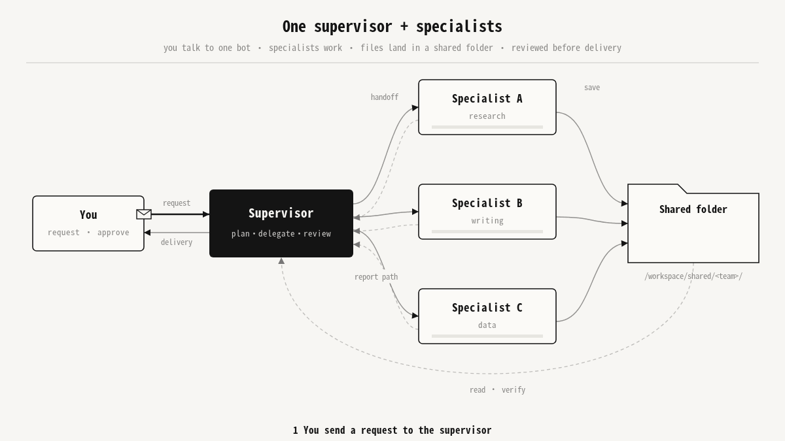

# Bot Team Playbook

**English** | [中文](README.zh-CN.md)

**One person, one bot team: a supervisor bot plus focused specialists that delegate, hand off and verify — with copy-ready prompts for 8 personas.**

[](LICENSE)


Most people use an AI assistant as a single chat box and pour everything into it — drafting, email, research, spreadsheets. Context gets messy and output gets inconsistent.

This playbook takes a different approach for **Grok Bot**, which can run several bots at once: each bot has its own conversation, description prompt (persona), memory, scheduled routines and connected tools (Gmail, Calendar, Slack, GitHub, X, Notion…). All bots share one cloud computer (shared files) but have their own desktop and browser, and they can message each other.

So a team runs on two things: **messages** (handoffs and reports) and **shared folders** (deliverables).

---

## What you get

- **8 ready-made teams** for 8 personas, each with 1 supervisor + 3–4 specialists;
- **35 copy-ready prompts** — one file per bot, every one built on the same 7-part structure;
- handoff / report message templates, a shared-folder convention and acceptance checklists;
- an installable [`skill/SKILL.md`](skill/SKILL.md) that lets an agent design a custom team for any user;
- the original interactive playbook ([`docs/playbook.html`](docs/playbook.html)) and a long-form article ([`docs/x-article.md`](docs/x-article.md)).

> The prompts and scenario guides are written in **Chinese** (the original language of the playbook). This English README summarizes them.

---

## The pattern: one supervisor + specialists



1. You send a request to the **supervisor** — your single daily entry point.
2. The supervisor breaks it down and messages each specialist with the deliverable and acceptance criteria.
3. Specialists save their work to `/workspace/shared/<team>/<bot>/` and report the file path back.
4. The supervisor opens the files and checks every acceptance criterion.
5. Only work that passes is delivered to you.

Why it works: one entry point for you; each specialist's prompt, memory and tools stay focused; every deliverable lands in a shared folder, so it is traceable and reusable. "Doing" and "checking" are split (e.g. coding vs. review, writing vs. fact-check), and any bot that touches the outside world only produces **drafts**.

---

## The 7 prompt components

Every bot prompt in this repo follows the same structure ([skeleton](templates/prompt-skeleton.md)):

| # | Component | What to write | Example (translated) |
|---|---|---|---|
| ① | Role | One line: who it is, whom it serves, core goal | You are the "Topic Researcher", finding high-potential topics for a tech video creator. |
| ② | Scope & boundaries | What it owns — and what it explicitly never does | Research and suggestions only; never posts or replies. |
| ③ | Output format | File type, structure, length, table columns, naming, save path | Markdown table: topic \| source link \| heat \| suggested angle. |
| ④ | Tone | Writing style toward you / outsiders | Conclusion first, conversational but professional. |
| ⑤ | Workflow | Numbered steps, ending with a self-check | 1. scan → 2. dedupe → 3. score → 4. self-check → 5. save & report |
| ⑥ | When to ask | Sending, spending, deleting, missing info, ambiguity | Anything outbound is a draft until you confirm. |
| ⑦ | Collaboration | Who the supervisor is, where files go, what to report | Save to `/workspace/shared/creator/research/`, then send the path and summary to the Content Lead. |

---

## Quick start

1. **Pick a scenario** from the table below (or use the [skill](skill/SKILL.md) to design your own).
2. **Create the bots** — the supervisor first, then each specialist.
3. **Paste the prompt as the description** — open `scenarios/<id>/prompts/<bot>.md` and copy the whole code block into that bot's description.
4. **Connect tools** — only the suggested ones you actually use.
5. **Set routines** — specialists run *before* the supervisor's daily summary (e.g. 07:30 collect → 08:30 brief). Times are examples; adjust to your time zone.
6. **Create the shared folder** `/workspace/shared/<id>/` as shown in each scenario, then send the supervisor a real request to test the loop.

---

<a id="scenarios"></a>

## Scenarios

| Persona | Who it's for | Team | Bots | Folder |
|---|---|---|---|---|
| 🎬 **Content Creator**<br>内容创作者 | Bloggers, video makers, newsletter / social editors: topic research → scripts → multi-platform distribution → performance recap. | Content Lead + Topic Researcher, Scriptwriter, Distribution Ops | 4 | [`scenarios/creator/`](scenarios/creator/) |
| 🛠️ **AI Builder** | Indie hackers and small dev teams: planning, coding, code review, AI/tech research, docs & releases. | Tech Lead + Coding Engineer, Code Reviewer, AI Researcher, Docs & Release | 5 | [`scenarios/builder/`](scenarios/builder/) |
| 🏪 **Small Business Owner**<br>小企业主 | Owner-operators: daily briefing, customer-support drafts, bookkeeping reminders, marketing copy. | GM Assistant + Customer Support, Finance Assistant, Marketing Assistant | 4 | [`scenarios/smb/`](scenarios/smb/) |
| 💼 **Freelancer / Consultant**<br>自由职业者/咨询师 | Solo professionals: lead research & outreach drafts, proposals and reports, quotes, invoices, payment follow-ups. | Business Lead + Prospecting Assistant, Delivery Assistant, Billing Assistant | 4 | [`scenarios/freelancer/`](scenarios/freelancer/) |
| 🛒 **E-commerce Seller**<br>电商卖家 | Online sellers: product sourcing, listing copy, after-sales email drafts, daily sales reports from your exports. | Store Lead + Sourcing Analyst, Listing Copywriter, Customer Support, Data Analyst | 5 | [`scenarios/ecom/`](scenarios/ecom/) |
| 🎓 **Student / Researcher**<br>学生/研究者 | Students and academics: literature review, writing feedback (advice only, no ghost-writing), reproducible data analysis. | Research Lead + Literature Researcher, Writing Advisor, Data Analyst | 4 | [`scenarios/research/`](scenarios/research/) |
| 📈 **Investor / Trader**<br>投资者/交易员 | Self-directed investors: market intel, filings-based research notes, trade-journal review against your own rules. Information only — not investment advice. | Research Lead (Investing) + Market Intel, Research Analyst, Risk & Review | 4 | [`scenarios/invest/`](scenarios/invest/) |
| 🤝 **Sales / Marketing**<br>销售/市场营销 | Account executives and marketers: account research, meeting & negotiation prep, follow-up drafts, pipeline review. | Sales Lead + Account Researcher, Meeting Strategist, Follow-up Assistant, Pipeline Analyst | 5 | [`scenarios/sales/`](scenarios/sales/) |

Each scenario folder contains a `README.md` (overview, mermaid diagram, bot table, handoff example, shared-folder tree, acceptance checklist, tips) and a `prompts/` folder with one prompt per bot.

---

## Use as a skill

[`skill/SKILL.md`](skill/SKILL.md) packages the full method — user discovery, team design, the 7-part prompt, shared-folder convention, handoff/report templates, acceptance, routines and delivery format — so an agent can design a custom bot team for any user. Copy the `skill/` folder into your agent's skills directory, or paste the file as context.

```text
Use the bot-team-playbook skill to design a bot team for me.
Who I am: [role]   Goal: [what to save time on]
Tools I use: [Gmail / Calendar / Slack / GitHub / X / Notion …]
Red lines: [what must always wait for my confirmation]
```

---

## Repository structure

```text
bot-team-playbook/
├── README.md                     # English README
├── README.zh-CN.md               # Chinese README
├── skill/
│   └── SKILL.md                  # Installable skill (frontmatter + full method)
├── scenarios/                    # 8 scenarios, one folder each
│   ├── creator/
│   │   ├── README.md             # team overview, diagram, bot table, handoff example, checklist
│   │   └── prompts/*.md          # one copy-ready prompt per bot (35 total)
│   ├── builder/  smb/  freelancer/  ecom/
│   └── research/  invest/  sales/
├── templates/                    # reusable templates
│   ├── handoff.md
│   ├── report.md
│   ├── prompt-skeleton.md
│   └── acceptance-checklist.md
├── docs/                         # original playbook & article
│   ├── playbook.html             # interactive 8-tab playbook (Chinese, open in a browser)
│   └── x-article.md              # X long-form article (Chinese)
├── CONTRIBUTING.md
└── LICENSE
```

---

## Safety principles

- **Drafts only for anything outbound** — emails, posts, messages and Slack replies wait for your confirmation.
- **No irreversible actions without you** — sending, publishing, paying, trading, deleting or committing to terms.
- **No fabrication** — unknown facts are marked "unknown" or 【待核实】 (to be verified).
- **Raw data is read-only** — bots read exports you drop into `data/` and never log into stores, CRMs or brokerages.
- **Each bot writes only its own folder** — it may read others' outputs but never edits them.
- **Investing content is information only** and is not investment advice; bots never place or recommend specific orders.

---

## Contributing

New scenarios, better prompts and translations are welcome — see [CONTRIBUTING.md](CONTRIBUTING.md).

---

> ### More open-source projects from Su
>
> **[Browse Su's other open-source projects →](https://github.com/doublesq97-ui/su-mit-index)**

---

## License

MIT · see [LICENSE](LICENSE)
