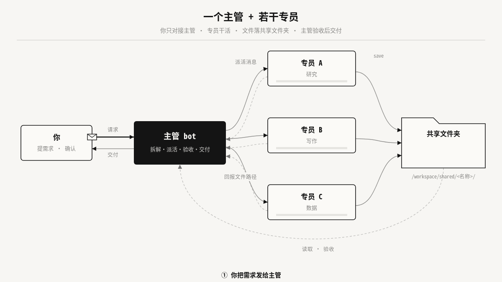

# Bot Team Playbook · 多 Bot 团队手册

[English](README.md) | **中文**

**一个人，一支 Bot 团队：一个主管 bot 当你的唯一入口，下面配几个各司其职的专员 bot——会分工、会交接、会验收。8 种身份，提示词直接复制。**

[](LICENSE)


> 你不需要一个更聪明的助手，你需要一支会分工、会交接、会验收的团队。

Grok Bot 可以同时运行多个助手 bot：每个 bot 有自己的对话、描述提示词（人设）、记忆、定时例行任务和连接的工具（如 Gmail、Calendar、Slack、GitHub、X、Notion）。所有 bot 共用同一台云电脑（文件共享），但各自拥有独立的桌面和浏览器，并且可以互相发消息。

因此团队协作靠两样东西：**消息**（派活、回报）和**共享文件夹**（交付物）。

---

## 你能从这个仓库带走什么

- **8 支现成团队**：8 种用户类型，每支 1 个主管 + 3–4 个专员；
- **35 份可直接复制的提示词**：每个 bot 一个文件，全部按同一套 7 部分结构写成；
- 派活 / 回报消息模板、共享文件夹约定和验收清单；
- 一个可安装的 [`skill/SKILL.md`](skill/SKILL.md)，让 Agent 为任何用户定制团队；
- 原版交互式手册 [`docs/playbook.html`](docs/playbook.html) 与 X 长文 [`docs/x-article.md`](docs/x-article.md)。

---

## 推荐模式：一个主管 + 若干专员



1. 你把需求发给「主管」
2. 主管拆解任务，发消息派给专员（写明交付物与验收标准）
3. 专员完成后存到 `/workspace/shared/<名称>/` 并把路径回报主管
4. 主管打开文件核对验收标准
5. 合格后交付给你

好处：你只需对接一个入口；每个专员的提示词、记忆和工具保持聚焦；所有产出都落在共享文件夹里，可追溯、可复用。"做"和"查"分开（编码与审查、写作与核实），任何涉及对外的专员都只出草稿。

---

## 提示词的 7 个部分

bot 的描述提示词决定它"是谁、做什么、怎么做"。本仓库每个 bot 的提示词都按这个结构写成（[骨架模板](templates/prompt-skeleton.md)）：

| # | 部分 | 写什么 | 示例 |
|---|---|---|---|
| ① | 角色定位 | 一句话：它是谁、服务谁、核心目标 | 你是「选题研究员」，为一位科技类视频博主寻找有传播潜力的选题。 |
| ② | 任务范围与边界 | 负责的事 + 明确不做的事（不代发、不付款、不发布） | 只做研究与建议；不发帖、不回复他人。 |
| ③ | 输出格式 | 文件类型、结构、字数、表格列、命名规则、保存路径 | Markdown 表格：选题 \| 依据链接 \| 热度判断 \| 建议角度。 |
| ④ | 语气 | 对用户/对外的写作风格 | 结论先行，口语化但专业。 |
| ⑤ | 工作流程 | 按步骤写，最后一步是自检 | 1. 扫描 → 2. 去重 → 3. 打分 → 4. 自检 → 5. 存档并回报。 |
| ⑥ | 何时询问用户 | 对外发送、花钱、删除、信息不足、存在多种理解时 | 任何对外发送的内容，先给草稿，等用户确认。 |
| ⑦ | 与其他 bot 的协作 | 主管是谁、和谁配合、文件存哪里、完成后回报什么 | 成果存到 `/workspace/shared/creator/research/`，完成后把路径和摘要发给「内容主管」。 |

小提示：用户确认过的长期偏好（固定格式、常用语气、客户名单）可以让 bot 记入记忆；但核心规则仍应写在提示词里。

---

## 快速开始

1. **选场景**：从下表挑一个最接近你的场景（或用 [Skill](skill/SKILL.md) 定制）。
2. **创建 bot**：先建主管，再建专员。
3. **粘贴提示词为描述**：打开 `scenarios/<id>/prompts/<bot>.md`，复制代码块全文，粘贴为该 bot 的描述。
4. **连接工具**：只连接建议列表中你实际在用的工具。
5. **设置例行任务**：专员先于主管汇总（如 07:30 收集素材 → 08:30 主管晨报）。时间均为示例，请按你的时区和作息调整。
6. **建共享文件夹**：按场景中的目录树创建 `/workspace/shared/<id>/`，给主管发一个真实需求试跑一次。

---

## 8 个场景

| 场景 | 适合谁 | 团队 | Bot 数 | 文件夹 |
|---|---|---|---|---|
| 🎬 **内容创作者** | 适合博主、视频作者、新媒体编辑。 | 内容主管（主管）+ 选题研究员、脚本撰稿人、分发运营 | 4 | [`scenarios/creator/`](scenarios/creator/) |
| 🛠️ **AI Builder** | 适合独立开发者和小型 AI 产品团队。 | 技术主管（主管）+ 编码工程师、代码审查员、AI 研究员、文档与发布 | 5 | [`scenarios/builder/`](scenarios/builder/) |
| 🏪 **小企业主** | 适合门店、工作室、小团队老板。 | 总经理助理（主管）+ 客服专员、财务助理、营销助理 | 4 | [`scenarios/smb/`](scenarios/smb/) |
| 💼 **自由职业者/咨询师** | 适合独立顾问、设计师、自由撰稿人等一人公司。 | 业务主管（主管）+ 拓客助理、交付助理、账务助理 | 4 | [`scenarios/freelancer/`](scenarios/freelancer/) |
| 🛒 **电商卖家** | 适合独立站和平台卖家。 | 店铺主管（主管）+ 选品分析师、商品文案、客服专员、数据分析员 | 5 | [`scenarios/ecom/`](scenarios/ecom/) |
| 🎓 **学生/研究者** | 适合本科生、研究生和科研人员。 | 研究主管（主管）+ 文献研究员、写作助理、数据分析员 | 4 | [`scenarios/research/`](scenarios/research/) |
| 📈 **投资者/交易员** | 适合个人投资者和交易员。 | 投研主管（主管）+ 市场情报员、研究分析师、风控复盘员 | 4 | [`scenarios/invest/`](scenarios/invest/) |
| 🤝 **销售/市场营销** | 适合销售、客户经理、BD 和市场营销人员，以及自己经营生意、管理客户的人。 | 销售主管（主管）+ 客户研究员、会议参谋、跟进助理、管道分析员 | 5 | [`scenarios/sales/`](scenarios/sales/) |

每个场景文件夹包含 `README.md`（团队概览、结构图、Bot 表、派活示例、共享文件夹、验收清单、管理技巧）和 `prompts/`（每个 bot 一份完整提示词）。

---

## 作为 Skill 使用

[`skill/SKILL.md`](skill/SKILL.md) 收录了完整方法：确定用户类型 → 设计团队 → 7 部分提示词 → 共享文件夹约定 → 派活/回报模板 → 验收 → 例行任务 → 交付格式。把 `skill/` 目录放进 Agent 的 Skills 目录，或直接把文件作为上下文交给 Agent：

```text
请用 bot-team-playbook Skill 帮我设计一支 bot 团队。
我是谁：[职业/角色]
核心目标：[想省下哪部分时间]
可用工具：[Gmail / Calendar / Slack / GitHub / X / Notion …]
红线：[哪些事必须我本人确认]
```

---

## 仓库结构

```text
bot-team-playbook/
├── README.md                     # 英文说明
├── README.zh-CN.md               # 中文说明
├── skill/
│   └── SKILL.md                  # 可安装的 Skill（frontmatter + 完整方法）
├── scenarios/                    # 8 个场景，每个场景一个文件夹
│   ├── creator/
│   │   ├── README.md             # 团队概览、结构图、Bot 表、派活示例、验收清单
│   │   └── prompts/*.md          # 每个 bot 一份可直接复制的提示词（共 35 份）
│   ├── builder/  smb/  freelancer/  ecom/
│   └── research/  invest/  sales/
├── templates/                    # 通用模板
│   ├── handoff.md
│   ├── report.md
│   ├── prompt-skeleton.md
│   └── acceptance-checklist.md
├── docs/                         # 原始手册与文章
│   ├── playbook.html             # 8 个标签页的交互式中文手册（浏览器打开）
│   └── x-article.md              # X 长文（中文）
├── CONTRIBUTING.md
└── LICENSE
```

---

## 安全原则

- **对外一律只出草稿**：邮件、帖子、消息、Slack 回复都等你确认后再发。
- **不可逆操作先问你**：发送、发布、付款、交易、删除、合同承诺。
- **不编造**：拿不到的事实写"未知"或标注【待核实】。
- **原始资料只读**：依赖外部系统（店铺后台、CRM、券商）时，由你把导出文件放进 `data/`，bot 不登录这些系统。
- **只写自己的目录**：读取别人的产出但不修改。
- **投资类内容只做信息整理**，不构成投资建议；bot 不执行交易、不建议具体下单。

---

## 参与贡献

欢迎补充新场景、改进提示词或翻译，见 [CONTRIBUTING.md](CONTRIBUTING.md)。

---

> ### 继续探索 Su 的开源项目
>
> **[查看 Su 的其他开源项目 →](https://github.com/doublesq97-ui/su-mit-index)**

---

## License

MIT · 见 [LICENSE](LICENSE)
