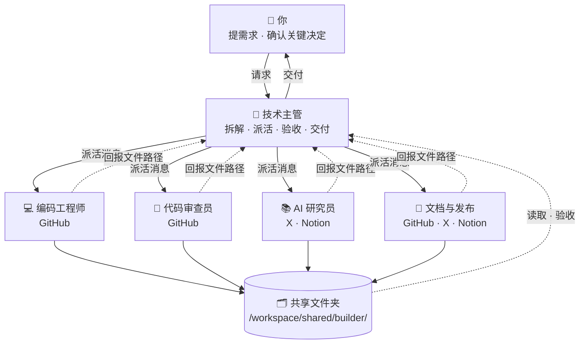

# 🛠️ AI Builder · Bot 团队

[← 返回总览](../../README.zh-CN.md) · [English overview](../../README.md#scenarios) · `builder`

**1 个主管 + 4 个专员，共 5 个 bot。**

适合独立开发者和小型 AI 产品团队。主管像技术负责人兼产品经理，把需求拆成编码、审查、研究、文档任务；所有 bot 共用一台云电脑，代码和产出在共享目录中流转。

---

## 团队结构



所有 bot 共用一台云电脑（文件共享），各自有独立的桌面与浏览器；bot 之间通过消息协作。

---

## Bot 一览

| Bot | 角色 | 职责 | 建议连接的工具 | 例行任务（示例） | 提示词 |
|---|---|---|---|---|---|
| 🧭 技术主管 | 主管 | 接收需求与 bug 报告，拆解为可执行任务，安排优先级，派给专员并验收；向你汇报进展与风险。 | GitHub · Slack · Calendar · Notion | 每个工作日 09:00 汇总 GitHub 上的新 Issue、待审 PR，给出今日优先级<br>每周五 16:00 本周进展周报：已合并、进行中、阻塞项 | [lead.md](prompts/lead.md) |
| 💻 编码工程师 | 专员 | 在云电脑上拉取代码、实现功能、修复 bug、跑测试，并在 GitHub 上提交分支和 PR。 | GitHub | 每晚 22:00 在主分支上运行完整测试，报告失败用例 | [coder.md](prompts/coder.md) |
| 🧪 代码审查员 | 专员 | 审查新 PR 的正确性、可读性和安全性，补充测试用例，给出审查意见草稿。 | GitHub | 每个工作日 11:00、16:00 检查新增或更新的 PR，生成审查意见 | [review.md](prompts/review.md) |
| 📚 AI 研究员 | 专员 | 跟踪模型、框架、论文和社区动态；做技术选型对比和小型验证实验。 | X · Notion | 每天 08:00 AI 动态简报：与产品相关的模型、工具、框架更新 | [research.md](prompts/research.md) |
| 📝 文档与发布 | 专员 | 维护 README 与使用文档，生成 changelog，起草发布帖子。 | GitHub · X · Notion | 每周四 15:00 根据本周合并的 PR 生成 changelog 草稿 | [docs.md](prompts/docs.md) |

---

## 如何搭建

1. **创建 bot**：为下表每个角色各建一个 bot（先建主管，再建专员），名称与提示词中的「」名称保持一致。
2. **粘贴提示词为描述**：打开对应的 `prompts/<bot>.md`，复制代码块全文，粘贴为该 bot 的描述（人设）。
3. **连接工具**：只连接表中建议的、且你已在使用的工具。
4. **设置例行任务**：按表中示例时间设置；专员的例行任务排在主管汇总之前。时间均为示例，请按你的时区和作息调整。
5. **建共享文件夹**：按下方目录树创建 `/workspace/shared/builder/`，由主管维护其中的 `README.md`。
6. **试跑一次**：用下面的派活示例给主管发一个真实需求，检查回报和验收是否按约定进行。

---

## 派活示例（主管 → 专员）

```text
@编码工程师 新任务（来自「技术主管」）

【任务】修复 Issue #42：长文本上传时接口超时
【背景】用户反馈超过 20MB 的文件上传会失败；相关代码在 upload 模块。
【交付物】
- 新分支上的修复与 PR
- 回报说明：根因、改动、测试结果
【验收标准】
1. 新增针对大文件的测试并通过
2. 全部现有测试通过
3. PR 描述包含复现步骤与验证方式
4. 未改动无关文件
【截止时间】明天 12:00 前
【保存路径】/workspace/shared/builder/coder/（文件名：YYYY-MM-DD-简短任务名）
【回报方式】完成后回复我：文件路径 + 3 行摘要 + 逐条自检结果 + 未解决问题。信息不足请先提问，不要猜测。
```

## 回报模板（专员 → 主管）

```text
@技术主管 任务已完成：「修复 Issue #42：长文本上传时接口超时」

【文件】/workspace/shared/builder/coder/2026-10-18-任务名.md
【摘要】（3 行以内）
【自检】
1. 新增针对大文件的测试并通过 —— ✅ 已满足 / ⚠️ 部分满足（原因）
2. 全部现有测试通过 —— ✅ 已满足 / ⚠️ 部分满足（原因）
3. PR 描述包含复现步骤与验证方式 —— ✅ 已满足 / ⚠️ 部分满足（原因）
4. 未改动无关文件 —— ✅ 已满足 / ⚠️ 部分满足（原因）
【未解决问题】（如无写“无”）
```

通用模板见 [`templates/handoff.md`](../../templates/handoff.md) 与 [`templates/report.md`](../../templates/report.md)。

---

## 共享文件夹

```text
/workspace/shared/builder/
├── lead/            ← 「技术主管」的产出
├── coder/           ← 「编码工程师」的产出
├── review/          ← 「代码审查员」的产出
├── research/        ← 「AI 研究员」的产出
├── docs/            ← 「文档与发布」的产出
└── README.md        ← 主管维护：目录说明、命名规则、当前进行中的任务
```

- 文件名统一为 `YYYY-MM-DD-简短任务名`，便于按日期查找。
- 每个 bot 只写自己的子文件夹，读取别人的产出但不修改。
- 原始资料只读，处理结果另存新文件。

## 本目录

```text
scenarios/builder/
├── README.md
└── prompts/
    ├── lead.md           # 技术主管
    ├── coder.md          # 编码工程师
    ├── review.md         # 代码审查员
    ├── research.md       # AI 研究员
    └── docs.md           # 文档与发布
```

---

## 验收检查（主管交付前）

- [ ] 文件存在，路径与派活消息一致
- [ ] 逐条对照验收标准，未满足项写明原因
- [ ] PR 链接可打开，CI/测试结果为通过
- [ ] diff 范围与任务一致，没有夹带无关改动
- [ ] 回报中的测试命令可在云电脑上复现
- [ ] 需要合并时交由你决定，主管不自行合并
- [ ] 不合格时附具体意见退回；两轮仍不达标，向你说明情况

通用清单见 [`templates/acceptance-checklist.md`](../../templates/acceptance-checklist.md)。

---

## 管理技巧

1. **一个任务一件事**：任务拆得越小，验收越容易；主管提示词里明确“一个 PR 只解决一个问题”。
2. **共享电脑当工作台**：各 bot 共用一台云电脑，代码克隆在固定目录（如 /workspace/repos/），避免各自重复拉取、版本混乱。
3. **审查与编码分开**：让不同 bot 写代码和审代码，形成天然的“第二双眼睛”。
4. **夜间测试 + 早间汇总**：编码工程师夜间跑测试，技术主管早上把失败项排进当天优先级。

---

> 涉及对外发送、付款、交易、删除等操作时，始终让 bot 先出草稿、由你确认。例行时间均为示例。
