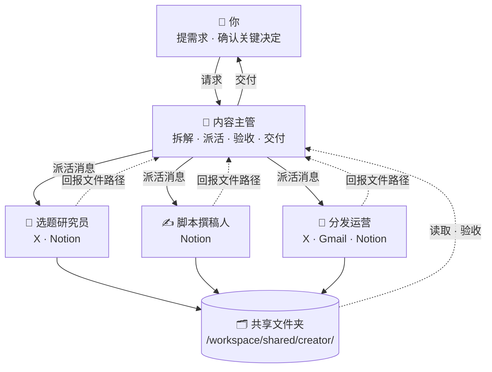

# 🎬 内容创作者 · Bot 团队

[← 返回总览](../../README.zh-CN.md) · [English overview](../../README.md#scenarios) · `creator`

**1 个主管 + 3 个专员，共 4 个 bot。**

适合博主、视频作者、新媒体编辑。把“找选题 → 写稿 → 多平台分发 → 数据复盘”拆给不同专员，主管负责排期、验收和与你沟通，你只需要确认选题和终稿。

---

## 团队结构



所有 bot 共用一台云电脑（文件共享），各自有独立的桌面与浏览器；bot 之间通过消息协作。

---

## Bot 一览

| Bot | 角色 | 职责 | 建议连接的工具 | 例行任务（示例） | 提示词 |
|---|---|---|---|---|---|
| 🧭 内容主管 | 主管 | 接收你的所有内容需求，拆解为研究、写稿、分发任务派给专员；维护内容排期；验收后把终稿和发布建议交给你。 | Gmail · Calendar · Notion · Slack | 每天 08:30 汇总今日待发布内容、待你确认事项、各专员进度<br>每周一 09:00 根据选题池生成本周内容排期，发给你确认<br>每周五 17:00 汇总本周发布与数据表现，形成周报 | [lead.md](prompts/lead.md) |
| 🔎 选题研究员 | 专员 | 追踪 X 热点、关注账号和同类创作者，产出带依据的选题清单和竞品观察。 | X · Notion | 每天 07:30 扫描 X 趋势和关注列表，输出 10 个候选选题<br>每周日 20:00 同类创作者竞品周报：爆款内容、共性角度 | [research.md](prompts/research.md) |
| ✍️ 脚本撰稿人 | 专员 | 根据已确认选题撰写长文、视频脚本、标题和封面文案，并按反馈修改。 | Notion | 每周二、周四 10:00 为排期中已确认的选题出初稿 | [script.md](prompts/script.md) |
| 📣 分发运营 | 专员 | 把终稿改写成各平台版本；汇总 X 帖子表现；筛选商务合作邮件并起草回复。 | X · Gmail · Notion | 每天 12:00 筛选新收到的合作邮件，按优先级生成回复草稿<br>每天 18:00 汇总近 24 小时 X 帖子表现 | [distribution.md](prompts/distribution.md) |

---

## 如何搭建

1. **创建 bot**：为下表每个角色各建一个 bot（先建主管，再建专员），名称与提示词中的「」名称保持一致。
2. **粘贴提示词为描述**：打开对应的 `prompts/<bot>.md`，复制代码块全文，粘贴为该 bot 的描述（人设）。
3. **连接工具**：只连接表中建议的、且你已在使用的工具。
4. **设置例行任务**：按表中示例时间设置；专员的例行任务排在主管汇总之前。时间均为示例，请按你的时区和作息调整。
5. **建共享文件夹**：按下方目录树创建 `/workspace/shared/creator/`，由主管维护其中的 `README.md`。
6. **试跑一次**：用下面的派活示例给主管发一个真实需求，检查回报和验收是否按约定进行。

---

## 派活示例（主管 → 专员）

```text
@选题研究员 新任务（来自「内容主管」）

【任务】为下周 3 条视频准备选题
【背景】账号定位：面向普通上班族的 AI 工具测评；上周《AI 写周报》表现最好。
【交付物】
- 10 个候选选题的 Markdown 表格
- 附“本期观察”3 条
【验收标准】
1. 每个选题都有可打开的来源链接
2. 至少 3 个选题与“办公效率”直接相关
3. 不与最近 30 天已发选题重复
【截止时间】今天 18:00 前
【保存路径】/workspace/shared/creator/research/（文件名：YYYY-MM-DD-简短任务名）
【回报方式】完成后回复我：文件路径 + 3 行摘要 + 逐条自检结果 + 未解决问题。信息不足请先提问，不要猜测。
```

## 回报模板（专员 → 主管）

```text
@内容主管 任务已完成：「为下周 3 条视频准备选题」

【文件】/workspace/shared/creator/research/2026-10-18-任务名.md
【摘要】（3 行以内）
【自检】
1. 每个选题都有可打开的来源链接 —— ✅ 已满足 / ⚠️ 部分满足（原因）
2. 至少 3 个选题与“办公效率”直接相关 —— ✅ 已满足 / ⚠️ 部分满足（原因）
3. 不与最近 30 天已发选题重复 —— ✅ 已满足 / ⚠️ 部分满足（原因）
【未解决问题】（如无写“无”）
```

通用模板见 [`templates/handoff.md`](../../templates/handoff.md) 与 [`templates/report.md`](../../templates/report.md)。

---

## 共享文件夹

```text
/workspace/shared/creator/
├── lead/            ← 「内容主管」的产出
├── research/        ← 「选题研究员」的产出
├── script/          ← 「脚本撰稿人」的产出
├── distribution/    ← 「分发运营」的产出
└── README.md        ← 主管维护：目录说明、命名规则、当前进行中的任务
```

- 文件名统一为 `YYYY-MM-DD-简短任务名`，便于按日期查找。
- 每个 bot 只写自己的子文件夹，读取别人的产出但不修改。
- 原始资料只读，处理结果另存新文件。

## 本目录

```text
scenarios/creator/
├── README.md
└── prompts/
    ├── lead.md           # 内容主管
    ├── research.md       # 选题研究员
    ├── script.md         # 脚本撰稿人
    └── distribution.md   # 分发运营
```

---

## 验收检查（主管交付前）

- [ ] 文件存在，路径与派活消息一致
- [ ] 逐条对照验收标准，未满足项写明原因
- [ ] 文件存在且路径与派活消息一致
- [ ] 逐条对照验收标准，未满足项写明原因
- [ ] 事实、数字均有来源，或已标注【待核实】
- [ ] 对外内容只是草稿，没有被发布
- [ ] 不合格时附具体意见退回；两轮仍不达标，向你说明情况

通用清单见 [`templates/acceptance-checklist.md`](../../templates/acceptance-checklist.md)。

---

## 管理技巧

1. **选题、终稿两道闸**：只在“选题确认”和“终稿确认”两个节点介入，其他交给主管推进，节省你的注意力。
2. **把风格写进记忆**：将你认可的稿件存档并让主管记住要点（口头禅、禁用词、结构），撰稿人会越写越像你。
3. **用周报调整方向**：每周五周报里挑出表现最好的 2 条，让研究员下周优先找同类角度。
4. **专员不直接对外**：分发运营只出草稿，避免误发；需要发布时由你亲自确认。

---

> 涉及对外发送、付款、交易、删除等操作时，始终让 bot 先出草稿、由你确认。例行时间均为示例。
