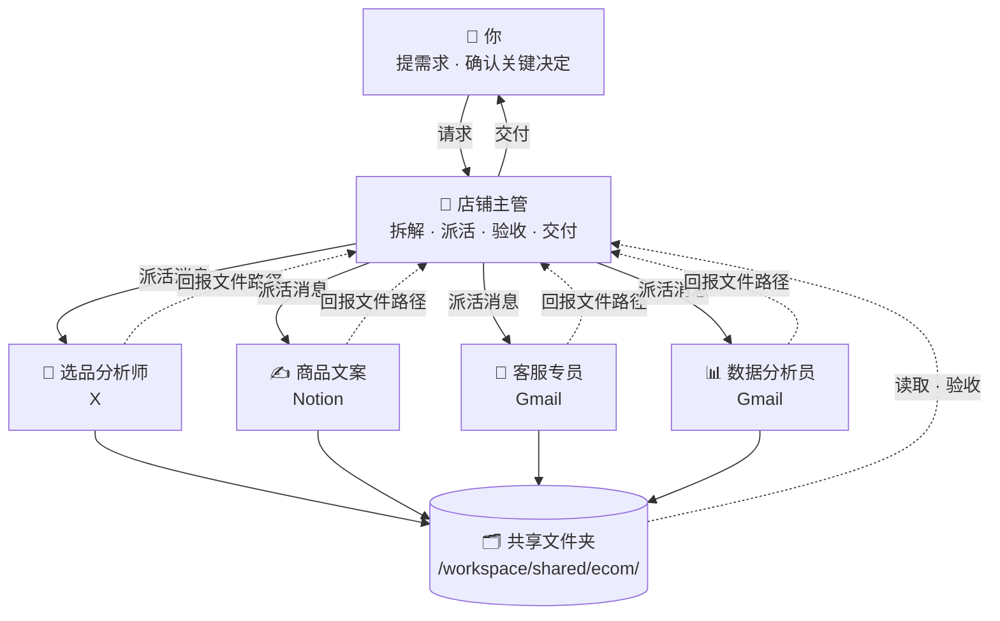

# 🛒 电商卖家 · Bot 团队

[← 返回总览](../../README.zh-CN.md) · [English overview](../../README.md#scenarios) · `ecom`

**1 个主管 + 4 个专员，共 5 个 bot。**

适合独立站和平台卖家。选品、文案、客服、数据各有专员；店铺后台数据以导出文件的方式放进共享文件夹，由数据分析员处理，主管整合成每日经营简报。

---

## 团队结构



所有 bot 共用一台云电脑（文件共享），各自有独立的桌面与浏览器；bot 之间通过消息协作。

---

## Bot 一览

| Bot | 角色 | 职责 | 建议连接的工具 | 例行任务（示例） | 提示词 |
|---|---|---|---|---|---|
| 🧭 店铺主管 | 主管 | 统筹选品、上新、客服与数据，每天给你一份经营简报，并协调各专员完成上新和活动。 | Gmail · Calendar · Slack · Notion | 每天 08:30 经营简报：昨日销售要点、客服待处理、今日上新/活动<br>每周一 10:00 本周运营计划：上新、促销、需要你决定的事项 | [lead.md](prompts/lead.md) |
| 🔎 选品分析师 | 专员 | 研究竞品价格、新品和趋势，评估候选商品的潜力。 | X | 每周一 09:00 竞品价格与新品周报<br>每月 1 日 品类趋势与候选新品清单 | [sourcing.md](prompts/sourcing.md) |
| ✍️ 商品文案 | 专员 | 撰写商品标题、卖点、详情页和多语言版本，优化旧商品文案。 | Notion | 每周三 10:00 为本周上新商品出文案初稿 | [copy.md](prompts/copy.md) |
| 💬 客服专员 | 专员 | 分类售后邮件，起草回复，汇总常见问题反馈给主管。 | Gmail | 每天 09:00、15:00 处理新售后邮件，生成分类与回复草稿 | [support.md](prompts/support.md) |
| 📊 数据分析员 | 专员 | 处理卖家导出放入共享文件夹的订单、流量数据，生成日报和专题分析。 | Gmail | 每天 08:00 读取 /workspace/shared/ecom/data/ 中最新导出文件，生成销售日报<br>每周一 08:00 周度分析：爆款、滞销、退货率 | [data.md](prompts/data.md) |

---

## 如何搭建

1. **创建 bot**：为下表每个角色各建一个 bot（先建主管，再建专员），名称与提示词中的「」名称保持一致。
2. **粘贴提示词为描述**：打开对应的 `prompts/<bot>.md`，复制代码块全文，粘贴为该 bot 的描述（人设）。
3. **连接工具**：只连接表中建议的、且你已在使用的工具。
4. **设置例行任务**：按表中示例时间设置；专员的例行任务排在主管汇总之前。时间均为示例，请按你的时区和作息调整。
5. **建共享文件夹**：按下方目录树创建 `/workspace/shared/ecom/`，由主管维护其中的 `README.md`。
6. **试跑一次**：用下面的派活示例给主管发一个真实需求，检查回报和验收是否按约定进行。

---

## 派活示例（主管 → 专员）

```text
@商品文案 新任务（来自「店铺主管」）

【任务】为 3 款新品撰写商品页面文案
【背景】参数表在 /workspace/shared/ecom/sourcing/2026-10-new-items.csv；目标客户为露营新手。
【交付物】
- 每款：3 个标题备选、5 条卖点、详情页文案
- 英文版本
【验收标准】
1. 标题长度符合平台限制
2. 参数与参数表完全一致
3. 无绝对化用语
4. 每款至少回应 2 个竞品评价中的常见疑问
【截止时间】周三 18:00 前
【保存路径】/workspace/shared/ecom/copy/（文件名：YYYY-MM-DD-简短任务名）
【回报方式】完成后回复我：文件路径 + 3 行摘要 + 逐条自检结果 + 未解决问题。信息不足请先提问，不要猜测。
```

## 回报模板（专员 → 主管）

```text
@店铺主管 任务已完成：「为 3 款新品撰写商品页面文案」

【文件】/workspace/shared/ecom/copy/2026-10-18-任务名.md
【摘要】（3 行以内）
【自检】
1. 标题长度符合平台限制 —— ✅ 已满足 / ⚠️ 部分满足（原因）
2. 参数与参数表完全一致 —— ✅ 已满足 / ⚠️ 部分满足（原因）
3. 无绝对化用语 —— ✅ 已满足 / ⚠️ 部分满足（原因）
4. 每款至少回应 2 个竞品评价中的常见疑问 —— ✅ 已满足 / ⚠️ 部分满足（原因）
【未解决问题】（如无写“无”）
```

通用模板见 [`templates/handoff.md`](../../templates/handoff.md) 与 [`templates/report.md`](../../templates/report.md)。

---

## 共享文件夹

```text
/workspace/shared/ecom/
├── lead/            ← 「店铺主管」的产出
├── sourcing/        ← 「选品分析师」的产出
├── copy/            ← 「商品文案」的产出
├── support/         ← 「客服专员」的产出
├── data/            ← 「数据分析员」的产出
├── data/            ← 你放入的店铺后台导出文件（订单、流量）
└── README.md        ← 主管维护：目录说明、命名规则、当前进行中的任务
```

- 文件名统一为 `YYYY-MM-DD-简短任务名`，便于按日期查找。
- 每个 bot 只写自己的子文件夹，读取别人的产出但不修改。
- 原始资料只读，处理结果另存新文件。

## 本目录

```text
scenarios/ecom/
├── README.md
└── prompts/
    ├── lead.md           # 店铺主管
    ├── sourcing.md       # 选品分析师
    ├── copy.md           # 商品文案
    ├── support.md        # 客服专员
    └── data.md           # 数据分析员
```

---

## 验收检查（主管交付前）

- [ ] 文件存在，路径与派活消息一致
- [ ] 逐条对照验收标准，未满足项写明原因
- [ ] 数字与原始数据文件一致（抽查）
- [ ] 文案无违规用语、参数准确
- [ ] 售后回复仍为草稿
- [ ] 建议动作具体到商品和时间
- [ ] 不合格时附具体意见退回；两轮仍不达标，向你说明情况

通用清单见 [`templates/acceptance-checklist.md`](../../templates/acceptance-checklist.md)。

---

## 管理技巧

1. **数据走文件**：把店铺后台导出的文件按固定文件名放进 data 文件夹，数据分析员的例行任务就能稳定运行。
2. **规则写进记忆**：毛利底线、品牌禁用词、售后政策让主管记住，所有专员按同一标准工作。
3. **上新流水线**：选品 → 文案 → 主管验收 → 你确认，固定顺序可以大幅缩短上新时间。
4. **高频问题回流**：客服汇总的高频问题交给商品文案改进详情页，从源头减少咨询。

---

> 涉及对外发送、付款、交易、删除等操作时，始终让 bot 先出草稿、由你确认。例行时间均为示例。
