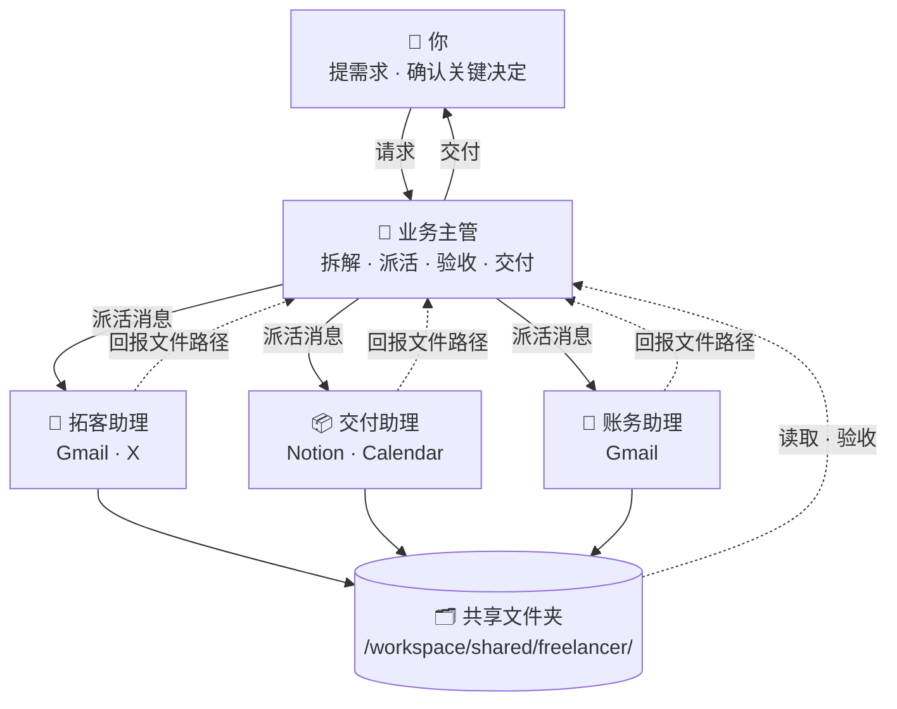

# 💼 自由职业者/咨询师 · Bot 团队

[← 返回总览](../../README.zh-CN.md) · [English overview](../../README.md#scenarios) · `freelancer`

**1 个主管 + 3 个专员，共 4 个 bot。**

适合独立顾问、设计师、自由撰稿人等一人公司。主管管理你的客户与时间，拓客、交付、账务三个专员覆盖“找客户 → 做项目 → 收款”的完整闭环。

---

## 团队结构



所有 bot 共用一台云电脑（文件共享），各自有独立的桌面与浏览器；bot 之间通过消息协作。

---

## Bot 一览

| Bot | 角色 | 职责 | 建议连接的工具 | 例行任务（示例） | 提示词 |
|---|---|---|---|---|---|
| 🧭 业务主管 | 主管 | 管理客户、项目和日程，统一接收请求并派给专员，确保每个项目按时交付、按时收款。 | Gmail · Calendar · Notion · Slack | 每个工作日 08:30 今日日程、各项目截止事项、待回复客户邮件<br>每周一 09:00 项目看板：进行中项目、风险、本周目标 | [lead.md](prompts/lead.md) |
| 🎯 拓客助理 | 专员 | 研究潜在客户与行业动态，撰写个性化外联邮件草稿，跟进未回复的线索。 | Gmail · X | 每周二 10:00 研究 10 个符合画像的潜在客户，附外联草稿<br>每周四 15:00 列出 7 天未回复的线索和跟进草稿 | [bd.md](prompts/bd.md) |
| 📦 交付助理 | 专员 | 起草方案、报告和演示大纲，整理会议纪要与行动项。 | Notion · Calendar | 每个工作日 17:30 整理当天会议纪要与行动项（基于你提供的笔记或录音文字稿） | [delivery.md](prompts/delivery.md) |
| 🧾 账务助理 | 专员 | 根据项目生成报价单与发票草稿，追踪付款状态，起草礼貌的催款邮件。 | Gmail | 每周一 09:00 未付款发票清单与催款邮件草稿<br>每月最后一个工作日 本月收入汇总 | [billing.md](prompts/billing.md) |

---

## 如何搭建

1. **创建 bot**：为下表每个角色各建一个 bot（先建主管，再建专员），名称与提示词中的「」名称保持一致。
2. **粘贴提示词为描述**：打开对应的 `prompts/<bot>.md`，复制代码块全文，粘贴为该 bot 的描述（人设）。
3. **连接工具**：只连接表中建议的、且你已在使用的工具。
4. **设置例行任务**：按表中示例时间设置；专员的例行任务排在主管汇总之前。时间均为示例，请按你的时区和作息调整。
5. **建共享文件夹**：按下方目录树创建 `/workspace/shared/freelancer/`，由主管维护其中的 `README.md`。
6. **试跑一次**：用下面的派活示例给主管发一个真实需求，检查回报和验收是否按约定进行。

---

## 派活示例（主管 → 专员）

```text
@交付助理 新任务（来自「业务主管」）

【任务】为 A 客户起草“客服流程优化”诊断报告初稿
【背景】已完成两次访谈，笔记在 /workspace/shared/freelancer/delivery/a-client/notes/。
【交付物】
- 报告初稿（Markdown，约 2000 字）
- 一页执行摘要
【验收标准】
1. 包含现状、问题、建议、实施路线图四部分
2. 每条建议都对应访谈中的具体问题
3. 不出现客户未提供的数据
4. 执行摘要不超过 300 字
【截止时间】周四 18:00 前
【保存路径】/workspace/shared/freelancer/delivery/（文件名：YYYY-MM-DD-简短任务名）
【回报方式】完成后回复我：文件路径 + 3 行摘要 + 逐条自检结果 + 未解决问题。信息不足请先提问，不要猜测。
```

## 回报模板（专员 → 主管）

```text
@业务主管 任务已完成：「为 A 客户起草“客服流程优化”诊断报告初稿」

【文件】/workspace/shared/freelancer/delivery/2026-10-18-任务名.md
【摘要】（3 行以内）
【自检】
1. 包含现状、问题、建议、实施路线图四部分 —— ✅ 已满足 / ⚠️ 部分满足（原因）
2. 每条建议都对应访谈中的具体问题 —— ✅ 已满足 / ⚠️ 部分满足（原因）
3. 不出现客户未提供的数据 —— ✅ 已满足 / ⚠️ 部分满足（原因）
4. 执行摘要不超过 300 字 —— ✅ 已满足 / ⚠️ 部分满足（原因）
【未解决问题】（如无写“无”）
```

通用模板见 [`templates/handoff.md`](../../templates/handoff.md) 与 [`templates/report.md`](../../templates/report.md)。

---

## 共享文件夹

```text
/workspace/shared/freelancer/
├── lead/            ← 「业务主管」的产出
├── bd/              ← 「拓客助理」的产出
├── delivery/        ← 「交付助理」的产出
├── billing/         ← 「账务助理」的产出
├── clients/         ← 每个客户一个子文件夹（背景、合同、往来资料）
└── README.md        ← 主管维护：目录说明、命名规则、当前进行中的任务
```

- 文件名统一为 `YYYY-MM-DD-简短任务名`，便于按日期查找。
- 每个 bot 只写自己的子文件夹，读取别人的产出但不修改。
- 原始资料只读，处理结果另存新文件。

## 本目录

```text
scenarios/freelancer/
├── README.md
└── prompts/
    ├── lead.md           # 业务主管
    ├── bd.md             # 拓客助理
    ├── delivery.md       # 交付助理
    └── billing.md        # 账务助理
```

---

## 验收检查（主管交付前）

- [ ] 文件存在，路径与派活消息一致
- [ ] 逐条对照验收标准，未满足项写明原因
- [ ] 结构与派活要求一致，字数在范围内
- [ ] 客户名称、日期、金额准确无误
- [ ] 对外文件只交给你，不由 bot 直接发给客户
- [ ] 行动项均有负责人和截止日
- [ ] 不合格时附具体意见退回；两轮仍不达标，向你说明情况

通用清单见 [`templates/acceptance-checklist.md`](../../templates/acceptance-checklist.md)。

---

## 管理技巧

1. **客户背景放共享文件夹**：每个客户一个子文件夹，所有专员都从同一处读背景，减少重复交代。
2. **拓客要稳定节奏**：每周固定研究 10 个线索比偶尔突击更有效，让例行任务替你坚持。
3. **收款自动提醒**：账务助理每周一检查逾期，你只需要确认并点击发送。
4. **复盘写进记忆**：项目结束后让主管记下客户偏好和教训，下次合作直接用上。

---

> 涉及对外发送、付款、交易、删除等操作时，始终让 bot 先出草稿、由你确认。例行时间均为示例。
