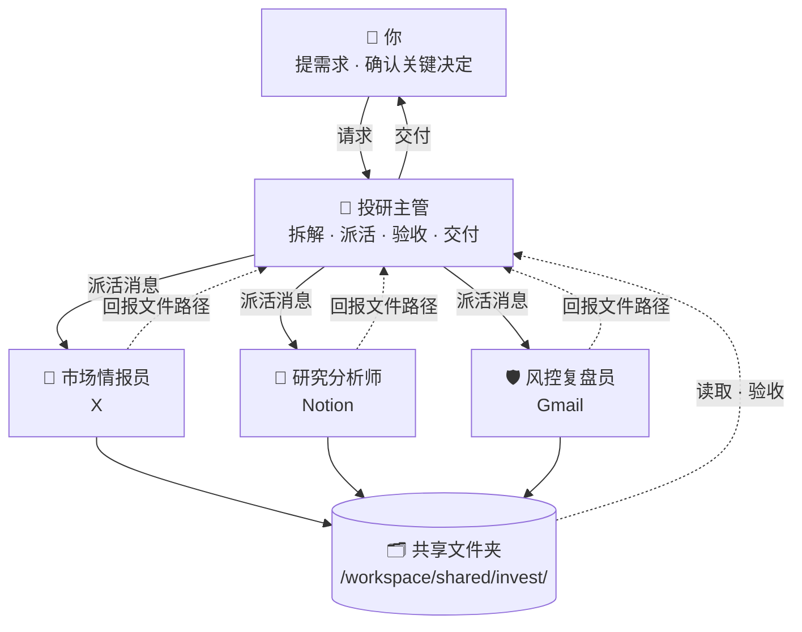

# 📈 投资者/交易员 · Bot 团队

[← 返回总览](../../README.zh-CN.md) · [English overview](../../README.md#scenarios) · `invest`

**1 个主管 + 3 个专员，共 4 个 bot。**

适合个人投资者和交易员。团队只做信息收集、研究与复盘，不执行任何交易。主管把盘前、盘后信息和研究结论整合给你，风控复盘员帮你守住自己定下的规则。

> ⚠️ 本团队所有内容仅为信息整理与复盘，不构成投资建议；bot 不执行交易、不建议具体下单。

---

## 团队结构



所有 bot 共用一台云电脑（文件共享），各自有独立的桌面与浏览器；bot 之间通过消息协作。

---

## Bot 一览

| Bot | 角色 | 职责 | 建议连接的工具 | 例行任务（示例） | 提示词 |
|---|---|---|---|---|---|
| 🧭 投研主管 | 主管 | 接收研究请求，统筹市场情报、深度研究和复盘，输出整合后的投研简报，提醒重要日程。 | Calendar · Notion · Slack · Gmail | 每个交易日 08:00 盘前简报：隔夜要闻、关注标的动态、今日重要事件<br>每周日 19:00 下周重要日程（财报、经济数据）与观察清单 | [lead.md](prompts/lead.md) |
| 📰 市场情报员 | 专员 | 监控 X 和新闻中与观察清单相关的动态，整理盘前、盘后要点。 | X | 每个交易日 07:30 收集隔夜新闻与 X 讨论，为盘前简报提供素材<br>每个交易日 16:30 收盘总结：关注标的的重要消息 | [intel.md](prompts/intel.md) |
| 🔬 研究分析师 | 专员 | 阅读公开财报和公告，在云电脑上建立简单的财务表与估值对比，撰写研究笔记。 | Notion | 财报季每周一 09:00 为本周发布财报的关注标的准备要点清单 | [analyst.md](prompts/analyst.md) |
| 🛡️ 风控复盘员 | 专员 | 根据你放入共享文件夹的交易记录做复盘，检查是否遵守你自己设定的规则。 | Gmail | 每周五 17:00 本周交易复盘：盈亏归因、规则执行情况<br>每月 1 日 月度复盘与行为模式总结 | [risk.md](prompts/risk.md) |

---

## 如何搭建

1. **创建 bot**：为下表每个角色各建一个 bot（先建主管，再建专员），名称与提示词中的「」名称保持一致。
2. **粘贴提示词为描述**：打开对应的 `prompts/<bot>.md`，复制代码块全文，粘贴为该 bot 的描述（人设）。
3. **连接工具**：只连接表中建议的、且你已在使用的工具。
4. **设置例行任务**：按表中示例时间设置；专员的例行任务排在主管汇总之前。时间均为示例，请按你的时区和作息调整。
5. **建共享文件夹**：按下方目录树创建 `/workspace/shared/invest/`，由主管维护其中的 `README.md`。
6. **试跑一次**：用下面的派活示例给主管发一个真实需求，检查回报和验收是否按约定进行。

---

## 派活示例（主管 → 专员）

```text
@研究分析师 新任务（来自「投研主管」）

【任务】为观察清单中的 X 公司准备财报前研究笔记
【背景】公司将于下周三发布季度财报；用户关心毛利率趋势与新业务进展。
【交付物】
- 研究笔记（Markdown）
- 近 8 个季度财务指标表（CSV）
【验收标准】
1. 数据来自公开财报并注明期间
2. 包含毛利率趋势与同业对比
3. 多空论点各至少 3 条
4. 列出财报中需重点关注的 5 个指标
【截止时间】下周一 20:00 前
【保存路径】/workspace/shared/invest/analyst/（文件名：YYYY-MM-DD-简短任务名）
【回报方式】完成后回复我：文件路径 + 3 行摘要 + 逐条自检结果 + 未解决问题。信息不足请先提问，不要猜测。
```

## 回报模板（专员 → 主管）

```text
@投研主管 任务已完成：「为观察清单中的 X 公司准备财报前研究笔记」

【文件】/workspace/shared/invest/analyst/2026-10-18-任务名.md
【摘要】（3 行以内）
【自检】
1. 数据来自公开财报并注明期间 —— ✅ 已满足 / ⚠️ 部分满足（原因）
2. 包含毛利率趋势与同业对比 —— ✅ 已满足 / ⚠️ 部分满足（原因）
3. 多空论点各至少 3 条 —— ✅ 已满足 / ⚠️ 部分满足（原因）
4. 列出财报中需重点关注的 5 个指标 —— ✅ 已满足 / ⚠️ 部分满足（原因）
【未解决问题】（如无写“无”）
```

通用模板见 [`templates/handoff.md`](../../templates/handoff.md) 与 [`templates/report.md`](../../templates/report.md)。

---

## 共享文件夹

```text
/workspace/shared/invest/
├── lead/            ← 「投研主管」的产出
├── intel/           ← 「市场情报员」的产出
├── analyst/         ← 「研究分析师」的产出
├── risk/            ← 「风控复盘员」的产出
├── data/            ← 交易记录、你的交易规则清单
└── README.md        ← 主管维护：目录说明、命名规则、当前进行中的任务
```

- 文件名统一为 `YYYY-MM-DD-简短任务名`，便于按日期查找。
- 每个 bot 只写自己的子文件夹，读取别人的产出但不修改。
- 原始资料只读，处理结果另存新文件。

## 本目录

```text
scenarios/invest/
├── README.md
└── prompts/
    ├── lead.md           # 投研主管
    ├── intel.md          # 市场情报员
    ├── analyst.md        # 研究分析师
    └── risk.md           # 风控复盘员
```

---

## 验收检查（主管交付前）

- [ ] 文件存在，路径与派活消息一致
- [ ] 逐条对照验收标准，未满足项写明原因
- [ ] 每个数字都有来源与期间
- [ ] 事实、观点、推测分开标注
- [ ] 没有出现下单指令式表述
- [ ] 风险与反方观点已列出
- [ ] 不合格时附具体意见退回；两轮仍不达标，向你说明情况

通用清单见 [`templates/acceptance-checklist.md`](../../templates/acceptance-checklist.md)。

---

## 管理技巧

1. **只做研究，不碰交易**：在所有提示词里写明不执行、不建议具体下单，团队定位为信息与纪律助手。
2. **规则写下来**：把你的交易规则写成清单放进共享文件夹并让主管记住，复盘员才能逐条检查。
3. **来源和时间戳**：要求每条信息带来源和时间，避免被过时或虚假信息误导。
4. **固定节奏**：盘前、收盘、周五复盘三个固定节点，让例行任务替你保持纪律。

---

> 涉及对外发送、付款、交易、删除等操作时，始终让 bot 先出草稿、由你确认。例行时间均为示例。
