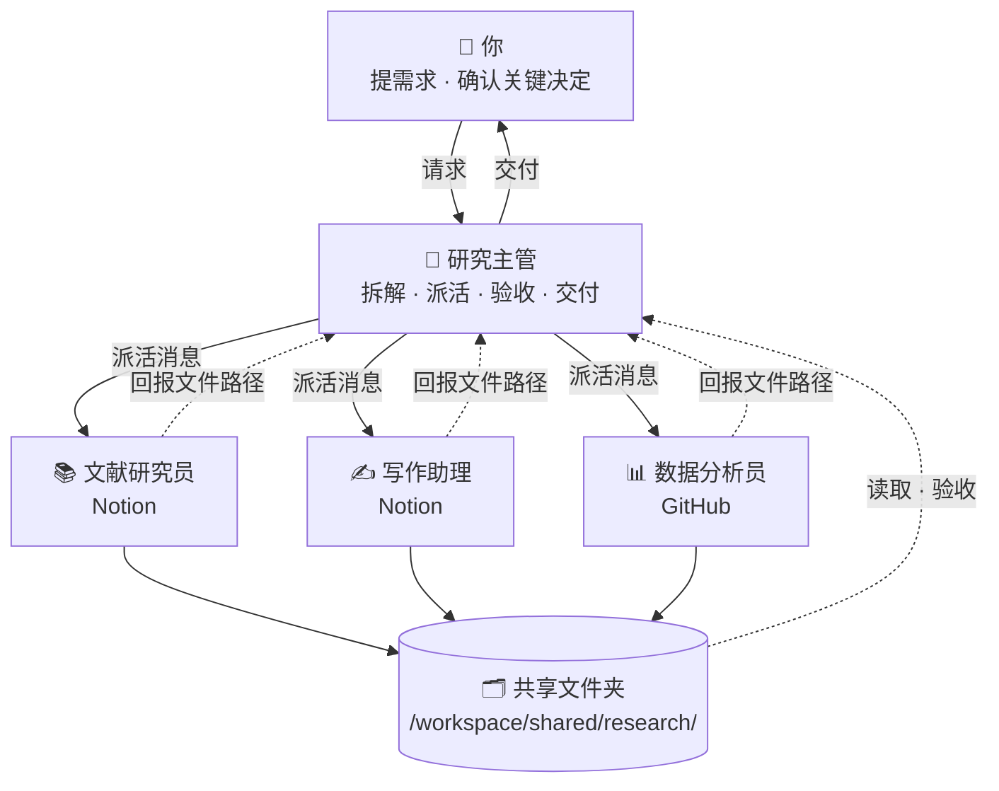

# 🎓 学生/研究者 · Bot 团队

[← 返回总览](../../README.zh-CN.md) · [English overview](../../README.md#scenarios) · `research`

**1 个主管 + 3 个专员，共 4 个 bot。**

适合本科生、研究生和科研人员。主管负责学习/研究规划与截止日期；文献、写作、数据三位专员分工协作。写作助理只提供结构与修改建议，帮助你遵守学术诚信。

---

## 团队结构



所有 bot 共用一台云电脑（文件共享），各自有独立的桌面与浏览器；bot 之间通过消息协作。

---

## Bot 一览

| Bot | 角色 | 职责 | 建议连接的工具 | 例行任务（示例） | 提示词 |
|---|---|---|---|---|---|
| 🧭 研究主管 | 主管 | 把课题拆成阶段性任务，管理截止日期和每周计划，派活并验收，帮你保持研究节奏。 | Calendar · Notion · Gmail | 每周日 20:00 下周学习/研究计划：目标、任务、截止日期<br>每天 21:00 今日进度回顾与明日要点 | [lead.md](prompts/lead.md) |
| 📚 文献研究员 | 专员 | 检索和筛选文献，撰写结构化摘要，维护文献表与综述框架。 | Notion | 每周一 08:00 研究方向相关的新论文简报 | [lit.md](prompts/lit.md) |
| ✍️ 写作助理 | 专员 | 给出论文结构建议、语言润色、逻辑检查和引用格式检查。 | Notion | 每周五 15:00 对本周新增的草稿给出修改意见 | [writing.md](prompts/writing.md) |
| 📊 数据分析员 | 专员 | 在云电脑上清洗数据、做统计分析和作图，代码可放到 GitHub 管理。 | GitHub | 每周三 10:00 检查数据文件夹中的新数据并更新分析结果 | [data.md](prompts/data.md) |

---

## 如何搭建

1. **创建 bot**：为下表每个角色各建一个 bot（先建主管，再建专员），名称与提示词中的「」名称保持一致。
2. **粘贴提示词为描述**：打开对应的 `prompts/<bot>.md`，复制代码块全文，粘贴为该 bot 的描述（人设）。
3. **连接工具**：只连接表中建议的、且你已在使用的工具。
4. **设置例行任务**：按表中示例时间设置；专员的例行任务排在主管汇总之前。时间均为示例，请按你的时区和作息调整。
5. **建共享文件夹**：按下方目录树创建 `/workspace/shared/research/`，由主管维护其中的 `README.md`。
6. **试跑一次**：用下面的派活示例给主管发一个真实需求，检查回报和验收是否按约定进行。

---

## 派活示例（主管 → 专员）

```text
@文献研究员 新任务（来自「研究主管」）

【任务】检索近 3 年关于“大语言模型在教育测评中的应用”的文献
【背景】用于硕士论文第二章综述；导师要求优先期刊和顶会论文。
【交付物】
- 不少于 15 篇的文献表
- 按主题分组的综述框架（只要提纲）
【验收标准】
1. 每篇都有可打开的出处链接
2. 发表时间在 2023 年及以后
3. 至少分成 3 个主题
4. 无法核实的条目明确标注
【截止时间】本周五 20:00 前
【保存路径】/workspace/shared/research/lit/（文件名：YYYY-MM-DD-简短任务名）
【回报方式】完成后回复我：文件路径 + 3 行摘要 + 逐条自检结果 + 未解决问题。信息不足请先提问，不要猜测。
```

## 回报模板（专员 → 主管）

```text
@研究主管 任务已完成：「检索近 3 年关于“大语言模型在教育测评中的应用”的文献」

【文件】/workspace/shared/research/lit/2026-10-18-任务名.md
【摘要】（3 行以内）
【自检】
1. 每篇都有可打开的出处链接 —— ✅ 已满足 / ⚠️ 部分满足（原因）
2. 发表时间在 2023 年及以后 —— ✅ 已满足 / ⚠️ 部分满足（原因）
3. 至少分成 3 个主题 —— ✅ 已满足 / ⚠️ 部分满足（原因）
4. 无法核实的条目明确标注 —— ✅ 已满足 / ⚠️ 部分满足（原因）
【未解决问题】（如无写“无”）
```

通用模板见 [`templates/handoff.md`](../../templates/handoff.md) 与 [`templates/report.md`](../../templates/report.md)。

---

## 共享文件夹

```text
/workspace/shared/research/
├── lead/            ← 「研究主管」的产出
├── lit/             ← 「文献研究员」的产出
├── writing/         ← 「写作助理」的产出
├── data/            ← 「数据分析员」的产出
├── data/            ← 原始数据（只读，处理结果另存）
└── README.md        ← 主管维护：目录说明、命名规则、当前进行中的任务
```

- 文件名统一为 `YYYY-MM-DD-简短任务名`，便于按日期查找。
- 每个 bot 只写自己的子文件夹，读取别人的产出但不修改。
- 原始资料只读，处理结果另存新文件。

## 本目录

```text
scenarios/research/
├── README.md
└── prompts/
    ├── lead.md           # 研究主管
    ├── lit.md            # 文献研究员
    ├── writing.md        # 写作助理
    └── data.md           # 数据分析员
```

---

## 验收检查（主管交付前）

- [ ] 文件存在，路径与派活消息一致
- [ ] 逐条对照验收标准，未满足项写明原因
- [ ] 抽查 3 篇文献，出处真实可查
- [ ] 结论与数据/文献对应，没有夸大
- [ ] 写作助理只给建议，没有替代你的写作
- [ ] 分析代码可复现
- [ ] 不合格时附具体意见退回；两轮仍不达标，向你说明情况

通用清单见 [`templates/acceptance-checklist.md`](../../templates/acceptance-checklist.md)。

---

## 管理技巧

1. **计划要倒排**：让主管从截止日期往前倒排里程碑，每周日自动生成下周计划。
2. **文献表是核心资产**：所有专员都引用同一份文献表，保证引用一致、可追溯。
3. **守住学术诚信**：在写作助理提示词里明确“只给建议、不代写”，并遵守学校与期刊规定。
4. **抽查出处**：验收时随机打开几条链接，是防止虚假引用最简单的办法。

---

> 涉及对外发送、付款、交易、删除等操作时，始终让 bot 先出草稿、由你确认。例行时间均为示例。
