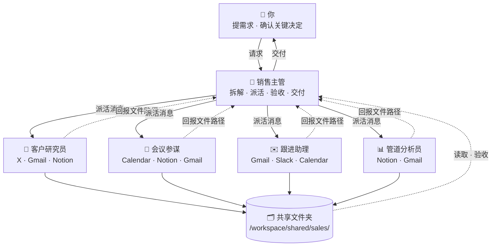

# 🤝 销售/市场营销 · Bot 团队

[← 返回总览](../../README.zh-CN.md) · [English overview](../../README.md#scenarios) · `sales`

**1 个主管 + 4 个专员，共 5 个 bot。**

适合销售、客户经理、BD 和市场营销人员，以及自己经营生意、管理客户的人。主管帮你盯住所有客户和单子（pipeline），客户研究、会议与谈判准备、跟进文案、管道分析各有专员；所有对外邮件和消息都只出草稿，由你确认后再发。

---

## 团队结构



所有 bot 共用一台云电脑（文件共享），各自有独立的桌面与浏览器；bot 之间通过消息协作。

---

## Bot 一览

| Bot | 角色 | 职责 | 建议连接的工具 | 例行任务（示例） | 提示词 |
|---|---|---|---|---|---|
| 🧭 销售主管 | 主管 | 管理客户名单和单子看板，统筹会前研究、会议简报、跟进草稿与 pipeline 复盘；每天告诉你今天该推进哪几单。 | Gmail · Calendar · Slack · Notion | 每个工作日 08:30 销售晨报：今日客户会议、需要跟进的单子、待回复的客户邮件<br>每周一 09:00 Pipeline 周会准备：各阶段单子、本周重点推进、风险单<br>每周五 17:00 本周销售周报：新增线索、推进/赢单/丢单、下周计划 | [lead.md](prompts/lead.md) |
| 🔎 客户研究员 | 专员 | 研究客户公司、关键联系人和行业动态，整理客户档案，找出可切入的需求和话题。 | X · Gmail · Notion | 每个工作日 07:30 为今明两天有会议的客户更新档案：最新动态、关键人、往来邮件要点<br>每周三 10:00 重点客户动态周报：融资、人事变动、新产品、X 上的公开讨论 | [research.md](prompts/research.md) |
| 🎯 会议参谋 | 专员 | 为销售会议和谈判准备会议简报、议程、提问清单、异议应对和谈判方案。 | Calendar · Notion · Gmail | 每个工作日 18:00 检查明天 Calendar 中的客户会议，生成会议简报<br>重要谈判前一天 15:00 谈判准备包：目标、底线、让步空间、可能异议 | [prep.md](prompts/prep.md) |
| ✉️ 跟进助理 | 专员 | 会后整理纪要与行动项，起草跟进邮件、报价说明和 Slack 消息草稿，提醒久未跟进的客户。 | Gmail · Slack · Calendar | 每个工作日 17:30 根据今天的会议笔记整理纪要，起草跟进邮件<br>每周二、周四 10:00 列出 7 天以上未联系的活跃单子，附跟进草稿 | [followup.md](prompts/followup.md) |
| 📊 管道分析员 | 专员 | 维护单子数据，做 pipeline 复盘：阶段分布、停滞单、赢单率和预测，给出推进建议。 | Notion · Gmail | 每周一 08:00 读取最新单子清单，生成 pipeline 复盘与停滞单清单<br>每月 1 日 09:00 月度销售分析：赢单/丢单原因、各阶段转化率、下月预测 | [pipeline.md](prompts/pipeline.md) |

---

## 如何搭建

1. **创建 bot**：为下表每个角色各建一个 bot（先建主管，再建专员），名称与提示词中的「」名称保持一致。
2. **粘贴提示词为描述**：打开对应的 `prompts/<bot>.md`，复制代码块全文，粘贴为该 bot 的描述（人设）。
3. **连接工具**：只连接表中建议的、且你已在使用的工具。
4. **设置例行任务**：按表中示例时间设置；专员的例行任务排在主管汇总之前。时间均为示例，请按你的时区和作息调整。
5. **建共享文件夹**：按下方目录树创建 `/workspace/shared/sales/`，由主管维护其中的 `README.md`。
6. **试跑一次**：用下面的派活示例给主管发一个真实需求，检查回报和验收是否按约定进行。

---

## 派活示例（主管 → 专员）

```text
@会议参谋 新任务（来自「销售主管」）

【任务】为周四与 C 公司的续约谈判准备会议简报和谈判准备包
【背景】客户档案在 /workspace/shared/sales/accounts/c-company/；当前合同年底到期，对方采购上周邮件提出希望降价 15%。用户可接受的折扣底线已写在该文件夹的 notes.md 中。
【交付物】
- 一页会议简报
- 谈判准备包（目标、底线、让步顺序、替代方案）
【验收标准】
1. 包含对方关键参会人及各自关注点
2. 针对“降价 15%”至少给出 3 种应对思路，并附依据
3. 让步顺序不突破用户给定的底线
4. 所有事实都能在客户档案或往来邮件中找到依据
【截止时间】周三 18:00 前
【保存路径】/workspace/shared/sales/prep/（文件名：YYYY-MM-DD-简短任务名）
【回报方式】完成后回复我：文件路径 + 3 行摘要 + 逐条自检结果 + 未解决问题。信息不足请先提问，不要猜测。
```

## 回报模板（专员 → 主管）

```text
@销售主管 任务已完成：「为周四与 C 公司的续约谈判准备会议简报和谈判准备包」

【文件】/workspace/shared/sales/prep/2026-10-18-任务名.md
【摘要】（3 行以内）
【自检】
1. 包含对方关键参会人及各自关注点 —— ✅ 已满足 / ⚠️ 部分满足（原因）
2. 针对“降价 15%”至少给出 3 种应对思路，并附依据 —— ✅ 已满足 / ⚠️ 部分满足（原因）
3. 让步顺序不突破用户给定的底线 —— ✅ 已满足 / ⚠️ 部分满足（原因）
4. 所有事实都能在客户档案或往来邮件中找到依据 —— ✅ 已满足 / ⚠️ 部分满足（原因）
【未解决问题】（如无写“无”）
```

通用模板见 [`templates/handoff.md`](../../templates/handoff.md) 与 [`templates/report.md`](../../templates/report.md)。

---

## 共享文件夹

```text
/workspace/shared/sales/
├── lead/            ← 「销售主管」的产出
├── research/        ← 「客户研究员」的产出
├── prep/            ← 「会议参谋」的产出
├── followup/        ← 「跟进助理」的产出
├── pipeline/        ← 「管道分析员」的产出
├── accounts/        ← 每个客户一个子文件夹（档案、往来要点、报价规则与底线）
├── data/            ← 你放入的单子清单导出（CSV/表格）
└── README.md        ← 主管维护：目录说明、命名规则、当前进行中的任务
```

- 文件名统一为 `YYYY-MM-DD-简短任务名`，便于按日期查找。
- 每个 bot 只写自己的子文件夹，读取别人的产出但不修改。
- 原始资料只读，处理结果另存新文件。

## 本目录

```text
scenarios/sales/
├── README.md
└── prompts/
    ├── lead.md           # 销售主管
    ├── research.md       # 客户研究员
    ├── prep.md           # 会议参谋
    ├── followup.md       # 跟进助理
    └── pipeline.md       # 管道分析员
```

---

## 验收检查（主管交付前）

- [ ] 文件存在，路径与派活消息一致
- [ ] 逐条对照验收标准，未满足项写明原因
- [ ] 对外邮件和 Slack 消息都只是草稿，没有被发送
- [ ] 价格、折扣、条款没有超出你给定的底线
- [ ] 客户信息有来源，事实与推测分开标注
- [ ] 单子看板的下一步和截止日已更新
- [ ] 不合格时附具体意见退回；两轮仍不达标，向你说明情况

通用清单见 [`templates/acceptance-checklist.md`](../../templates/acceptance-checklist.md)。

---

## 管理技巧

1. **每单都要有下一步**：让主管在看板里为每一单写明“下一步 + 截止日”，没有下一步的单子会被自动标为风险。
2. **会前一晚自动出简报**：会议参谋的例行任务会读取明天的日历，你只需在会前花 5 分钟看简报。
3. **底线写清楚**：把报价规则和折扣底线写进客户文件夹并让主管记住，谈判准备才不会越界。
4. **跟进只出草稿**：跟进助理写好草稿，你确认后再发；节奏由例行任务保证，决定权始终在你。

---

> 涉及对外发送、付款、交易、删除等操作时，始终让 bot 先出草稿、由你确认。例行时间均为示例。
