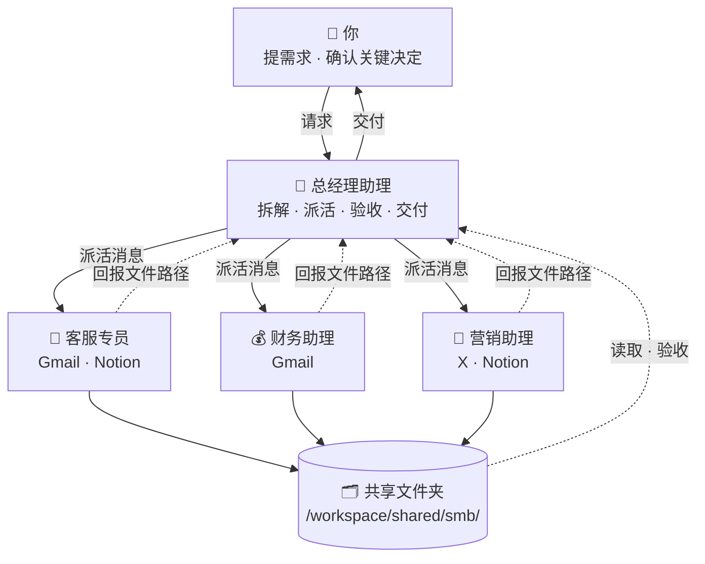

# 🏪 小企业主 · Bot 团队

[← 返回总览](../../README.zh-CN.md) · [English overview](../../README.md#scenarios) · `smb`

**1 个主管 + 3 个专员，共 4 个 bot。**

适合门店、工作室、小团队老板。主管像总经理助理，每天给你一份晨报；客服、财务、营销各有专员，所有对外邮件和付款类事项都只出草稿，由你拍板。

---

## 团队结构



所有 bot 共用一台云电脑（文件共享），各自有独立的桌面与浏览器；bot 之间通过消息协作。

---

## Bot 一览

| Bot | 角色 | 职责 | 建议连接的工具 | 例行任务（示例） | 提示词 |
|---|---|---|---|---|---|
| 🧭 总经理助理 | 主管 | 作为你的统一入口：整理日程与重要邮件，分派客服、财务、营销任务，跟进进度并汇报。 | Gmail · Calendar · Slack · Notion | 每个工作日 08:00 晨报：今日日程、重要邮件、待办和各专员进度<br>每周日 19:00 下周安排：会议、截止事项、需要你决定的事 | [lead.md](prompts/lead.md) |
| 💬 客服专员 | 专员 | 分类客户咨询邮件，按 FAQ 起草回复，整理常见问题库。 | Gmail · Notion | 工作日 10:00、14:00、17:00 检查新的客户咨询邮件，生成分类和回复草稿 | [support.md](prompts/support.md) |
| 💰 财务助理 | 专员 | 整理邮件中的发票与账单，维护收支表，提醒应收应付。 | Gmail | 每周五 16:00 应收账款与即将到期账单提醒<br>每月 1 日 09:00 上月收支汇总表与简要分析 | [finance.md](prompts/finance.md) |
| 📣 营销助理 | 专员 | 策划促销活动，撰写社媒帖子和邮件营销文案，跟踪 X 上的同行动态。 | X · Notion | 每周一 10:00 本周社媒内容草稿（3–5 条）<br>每月 25 日 下月促销活动方案草稿 | [marketing.md](prompts/marketing.md) |

---

## 如何搭建

1. **创建 bot**：为下表每个角色各建一个 bot（先建主管，再建专员），名称与提示词中的「」名称保持一致。
2. **粘贴提示词为描述**：打开对应的 `prompts/<bot>.md`，复制代码块全文，粘贴为该 bot 的描述（人设）。
3. **连接工具**：只连接表中建议的、且你已在使用的工具。
4. **设置例行任务**：按表中示例时间设置；专员的例行任务排在主管汇总之前。时间均为示例，请按你的时区和作息调整。
5. **建共享文件夹**：按下方目录树创建 `/workspace/shared/smb/`，由主管维护其中的 `README.md`。
6. **试跑一次**：用下面的派活示例给主管发一个真实需求，检查回报和验收是否按约定进行。

---

## 派活示例（主管 → 专员）

```text
@财务助理 新任务（来自「总经理助理」）

【任务】整理 9 月收支并找出异常支出
【背景】老板觉得 9 月支出偏高，想知道原因。
【交付物】
- 9 月收支表（CSV）
- 一页汇总分析（Markdown）
【验收标准】
1. 每条记录都有来源邮件主题或日期
2. 合计与明细一致
3. 列出金额最大的 5 项支出和与 8 月相比变化最大的 3 项
4. 异常项写明判断依据
【截止时间】周三 12:00 前
【保存路径】/workspace/shared/smb/finance/（文件名：YYYY-MM-DD-简短任务名）
【回报方式】完成后回复我：文件路径 + 3 行摘要 + 逐条自检结果 + 未解决问题。信息不足请先提问，不要猜测。
```

## 回报模板（专员 → 主管）

```text
@总经理助理 任务已完成：「整理 9 月收支并找出异常支出」

【文件】/workspace/shared/smb/finance/2026-10-18-任务名.md
【摘要】（3 行以内）
【自检】
1. 每条记录都有来源邮件主题或日期 —— ✅ 已满足 / ⚠️ 部分满足（原因）
2. 合计与明细一致 —— ✅ 已满足 / ⚠️ 部分满足（原因）
3. 列出金额最大的 5 项支出和与 8 月相比变化最大的 3 项 —— ✅ 已满足 / ⚠️ 部分满足（原因）
4. 异常项写明判断依据 —— ✅ 已满足 / ⚠️ 部分满足（原因）
【未解决问题】（如无写“无”）
```

通用模板见 [`templates/handoff.md`](../../templates/handoff.md) 与 [`templates/report.md`](../../templates/report.md)。

---

## 共享文件夹

```text
/workspace/shared/smb/
├── lead/            ← 「总经理助理」的产出
├── support/         ← 「客服专员」的产出
├── finance/         ← 「财务助理」的产出
├── marketing/       ← 「营销助理」的产出
└── README.md        ← 主管维护：目录说明、命名规则、当前进行中的任务
```

- 文件名统一为 `YYYY-MM-DD-简短任务名`，便于按日期查找。
- 每个 bot 只写自己的子文件夹，读取别人的产出但不修改。
- 原始资料只读，处理结果另存新文件。

## 本目录

```text
scenarios/smb/
├── README.md
└── prompts/
    ├── lead.md           # 总经理助理
    ├── support.md        # 客服专员
    ├── finance.md        # 财务助理
    └── marketing.md      # 营销助理
```

---

## 验收检查（主管交付前）

- [ ] 文件存在，路径与派活消息一致
- [ ] 逐条对照验收标准，未满足项写明原因
- [ ] 表格可打开、列名完整、合计核对无误
- [ ] 所有对外邮件都停留在草稿状态
- [ ] 敏感信息（客户、金额）只存放在共享文件夹，不写进公开内容
- [ ] “需要老板决定”的事项单独列出
- [ ] 不合格时附具体意见退回；两轮仍不达标，向你说明情况

通用清单见 [`templates/acceptance-checklist.md`](../../templates/acceptance-checklist.md)。

---

## 管理技巧

1. **晨报只放 3 个决定**：让主管把需要你拍板的事限制在 3 项以内，其余自动推进。
2. **草稿制度**：客服、营销对外内容一律是草稿；钱相关事项一律提醒，不代操作。
3. **FAQ 越用越准**：让客服专员每周把新问题整理进 FAQ，你确认后让它记住，回复质量会持续提升。
4. **月初一张表**：财务助理每月 1 日出收支表，存进固定文件夹，全年数据自然积累。

---

> 涉及对外发送、付款、交易、删除等操作时，始终让 bot 先出草稿、由你确认。例行时间均为示例。
